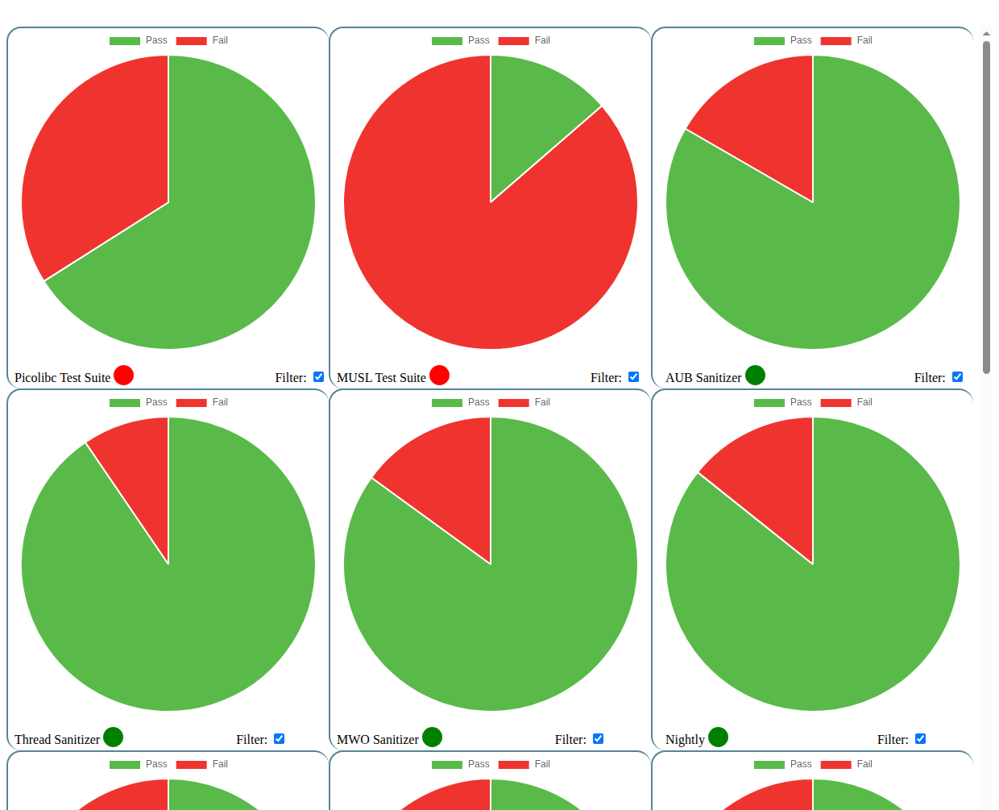

# ELD: Embedded LD

ELD is an ELF linker designed to meet the needs of embedded software projects.
It aims to be a drop-in replacement for the GNU linker, with a smaller memory
footprint, faster link times and a customizable link behavior.

ELD supports targets Hexagon, ARM, AArch64 and RISCV
and is designed for easy addition of more backends.

## Supported features
- Static linking
- Dynamic linking
- Partial linking
- LTO
- Same command-line options as GNU LD.
- Linker scripts. Linker script syntax is same as of GNU LD.
- Highly detailed linker map-files.

  Highly detailed map-files are essential to debug complex image layouts.
- Linker plugins

  Linker plugins allow a user to programmatically customize link
  behavior for advanced use-cases and complex image layouts.
- Reproduce functionality

  The reproduce functionality creates a tarball that can be used to reproduce the
  link without any other dependency.

## Building ELD and running tests

ELD supports building and running tests on Linux, Windows, and macOS (Darwin)
utilizing LLVM. macOS is supported as a **host** (Apple Silicon and Intel);
ELD still produces ELF images and does not link Mach-O. On macOS the linker
binary is built natively for the host architecture (`arm64` or `x86_64`);
universal binaries are not required.

ELD depends on LLVM. You can build ELD either:
- Integrated into an `llvm-project` build, or
- Against an external, prebuilt LLVM installation, such as an LLVM release or
  the LLVM packages of a Linux distribution (faster iteration if you already
  have an LLVM installation).

You will need a recent C++ compiler for building LLVM and ELD.

```
git clone https://github.com/llvm/llvm-project.git
cd llvm-project/
git clone https://github.com/qualcomm/eld.git
cd ../
cmake -G Ninja \
  -DCMAKE_BUILD_TYPE=Debug \
  -DCMAKE_INSTALL_PREFIX=../inst \
  -DLLVM_ENABLE_ASSERTIONS:BOOL=ON \
  -DLLVM_ENABLE_PROJECTS='llvm;clang' \
  -DLLVM_EXTERNAL_PROJECTS=eld \
  -DLLVM_EXTERNAL_ELD_SOURCE_DIR=${PWD}/llvm-project/eld \
  -DLLVM_TARGETS_TO_BUILD='ARM;AArch64;RISCV;Hexagon;X86' \
  -DCMAKE_CXX_FLAGS='-stdlib=libc++' \
  -B ./obj \
  -S ./llvm-project/llvm
cmake --build obj # Build the linker
cmake --build obj -- check-eld # Build test artifacts and run the tests
```

## Building ELD with an external LLVM installation

If you already have an installed LLVM/Clang "release" directory (with `bin/clang`, `bin/clang++`, `bin/llvm-tblgen`, and `lib/cmake/llvm`), you can configure ELD directly against it:

```bash
./configure_external_llvm.sh <LLVM_RELEASE_DIR> <ELD_BUILD_DIR>
cd <ELD_BUILD_DIR>
ninja
```

You can also configure ELD directly with CMake, for instance against the LLVM
packages of a Linux distribution:

```bash
cmake -G Ninja \
  -DCMAKE_BUILD_TYPE=Release \
  -DELD_USE_EXTERNAL_LLVM=ON \
  -DLLVM_DIR=/usr/lib/llvm-24/lib/cmake/llvm \
  -B <ELD_BUILD_DIR> \
  -S <ELD_SOURCE_DIR>
ninja -C <ELD_BUILD_DIR>
```

LLVM installations with static component libraries and LLVM installations
built as a single shared library (`LLVM_LINK_LLVM_DYLIB`, as in the Debian,
Ubuntu, Fedora and Arch packages) are both supported.

Notes:
- Tests are disabled by default for external builds; see
  [Running tests with an external LLVM](#running-tests-with-an-external-llvm)
  to enable them;
- To build just the linker: `ninja ld.eld`

### Running tests with an external LLVM

Configure with `-DELD_INCLUDE_TESTS=ON` to run tests against an external LLVM.
An LLVM build tree is used as is. With an LLVM installation, the tests
additionally need:

- `lit`, found next to the LLVM tools or in `PATH` (for instance from
  `pip install lit`), or given with `-DLLVM_EXTERNAL_LIT=/path/to/lit`;
- the LLVM test tools (`FileCheck`, `not`, `count`, `split-file`, `yaml2obj`,
  `obj2yaml`, ...) installed next to the other LLVM tools, e.g. from the
  `llvm-<version>-tools` package on Debian and Ubuntu. CMake warns about
  missing tools;
- GoogleTest for the unit tests, if LLVM does not provide it (LLVM
  installations usually don't). The unit tests are skipped if GoogleTest is
  not found.

Then run the tests as usual:

```bash
ninja -C <ELD_BUILD_DIR> check-eld
```

Tests that check the ELD or LLVM git revision in version information are
unsupported when that revision was not recorded, for instance when building
from source tarballs or with `-DELD_APPEND_VC_REV=OFF`.

### Packaging ELD

The following CMake options help distributions and other packagers integrate
ELD. Their defaults preserve the standard build and install layout.

Install paths may be relative to `CMAKE_INSTALL_PREFIX` or absolute. Relative
plugin and plugin-config paths are resolved from `ld.eld` at runtime.

- `-DCMAKE_INSTALL_RPATH_USE_LINK_PATH=OFF`

  By default, the directories of linked libraries, such as the library
  directory of an external LLVM, are recorded in the RUNPATH of `ld.eld` and
  `libLW`. Turn this off when LLVM is installed in the default library search
  path. The configured plugin directory remains available to the plugin
  search.

- `-DELD_TOOLS_INSTALL_DIR=<dir>` (default: `${CMAKE_INSTALL_BINDIR}`): install
  location for `ld.eld` and related tools.

- `-DELD_PLUGIN_DIR=<dir>` (default: `${CMAKE_INSTALL_LIBDIR}`): install
  location for linker plugins.

- `-DELD_PLUGIN_CONFIG_DIR=<dir>` (default:
  `${CMAKE_INSTALL_SYSCONFDIR}/ELD/Plugins`): install location for plugin
  configuration files.

- `-DELD_APPEND_VC_REV=OFF`

  By default, the git revision of the ELD source tree is recorded in version
  information (the `.comment` section of linked outputs, `--repository-version`
  and map files). Turn this off when building from a source tarball or from a
  packaging repository, whose revision is not an ELD revision. Git is then not
  needed to build ELD.

- `-DELD_INSTALL_PLUGINS=OFF`

  Build the in-tree plugins, such as `HelloWorldPlugin`, without installing
  them.

- `-DELD_TEMPLATES_INSTALL_DIR=share/eld/templates`

  Install the linker script templates to this directory instead of
  `templates`. A relative path is relative to the install prefix.

- `-DLLVM_USE_SYMLINKS=OFF`

  The `<target>-link` drivers (`aarch64-link`, `arm-link`, ...) are symlinks
  to `ld.eld` by default on Unix hosts. Turn this off to install copies
  instead, or pass `-DELD_CREATE_SYMLINKS=OFF` to not create these drivers.

Some (optional) helpful CMake options:

- `-DLLVM_USE_SPLIT_DWARF=On`

  This option helps save on disk space with debug builds

- `-DLLVM_PARALLEL_LINK_JOBS`

  Linking LLVM toolchain can be very memory-intensive. To avoid OOM or swap performance repurcussion, it is recommended to restrict parallel link jobs, especially in systems with less than 32 GB of memory.

- `-DLLVM_USE_LINKER=lld`

  Using LLD instead of GNU LD can signficantly help in reducing link time and memory.

### Running a Single Test Case
To execute an individual ELD test without running the entire suite, follow the steps below from the build directory ('obj/' here).

#### 1. Locate the Test Configuration and Test File

- **Test configurations** are stored under:
`obj/tools/eld/test/`

- **Test files** reside in the source tree, for example:
`llvm-project/eld/test/<Subdirectory>/<TestName>.test`

#### 2. Invoke the Test Harness

Use the following command to run a specific test case:

```bash
<path_to_lit_config> <path_to_test_file>
```

- `<path_to_lit_config>` : Path to the LIT configuration script
- `<path_to_test_file>` : Path to the '.test' file you wish to execute

#### Example
```bash
obj/tools/eld/test/llvm-lit-arm-default  llvm-project/eld/test/Common/standalone/AliasSymbolExportDynamic/AliasSymbolExportDynamic.test
```

This command runs only the AliasSymbolExportDynamic test using the ARM default configuration. Results and diagnostics will be printed to the console.

#### Enabling Verbose Output

- -a: Always show detailed output.
- -v: Show detailed output only when a test fails ("on failure" mode).

### Run Tests (Executing Linked Binaries)

Some tests actually execute the linked binaries to verify runtime behavior. These tests require a cross-compilation toolchain and an emulator (e.g., QEMU) to be configured.


Configure the project with `-DELD_ENABLE_RUN_TESTS=On` and set the
following environment variables for each target architecture you want
to enable run tests on:

| Architecture | C Compiler | C++ Compiler | Sysroot | Emulator |
|--------------|------------|--------------|---------|----------|
| AArch64 | `ELD_AARCH64_C_COMPILER` | `ELD_AARCH64_CXX_COMPILER` | `ELD_AARCH64_SYSROOT` | `ELD_AARCH64_EMULATOR` |
| ARM | `ELD_ARM_C_COMPILER` | `ELD_ARM_CXX_COMPILER` | `ELD_ARM_SYSROOT` | `ELD_ARM_EMULATOR` |
| RISCV32 | `ELD_RISCV32_C_COMPILER` | `ELD_RISCV32_CXX_COMPILER` | `ELD_RISCV32_SYSROOT` | `ELD_RISCV32_EMULATOR` |
| RISCV64 | `ELD_RISCV64_C_COMPILER` | `ELD_RISCV64_CXX_COMPILER` | `ELD_RISCV64_SYSROOT` | `ELD_RISCV64_EMULATOR` |
| X86_64 | `ELD_X86_64_C_COMPILER` | `ELD_X86_64_CXX_COMPILER` | `ELD_X86_64_SYSROOT` | `ELD_X86_64_EMULATOR` |

The `run_test` lit feature is enabled when the C compiler, sysroot, and emulator are all configured for a target. The `run_cxx_test` feature additionally requires the C++ compiler.

For `<TARGET>_C_COMPILER`, `<TARGET>_CXX_COMPILER`, and `<TARGET>_EMULATOR`,
you can provide either a full path or just the tool name
(which will be resolved via `PATH`).

#### Example: Configuring for AArch64

```bash
# CMake must be configured via -DELD_ENABLE_RUN_TESTS=On
export ELD_AARCH64_C_COMPILER=/usr/bin/aarch64-linux-gnu-gcc
export ELD_AARCH64_CXX_COMPILER=/usr/bin/aarch64-linux-gnu-g++
export ELD_AARCH64_SYSROOT=/usr/aarch64-linux-gnu
export ELD_AARCH64_EMULATOR=qemu-aarch64
```

### Summarizing Test Results Across Configurations

After running `check-eld`, you can print a consolidated result table across all
architecture/option configurations using the `check-eld-summary` target:

```bash
cmake --build obj -- check-eld-summary
# or with ninja:
ninja check-eld-summary
```

This reads the `results.json` file written by each lit sub-run and prints a
table.

If a configuration has not been run yet its row shows `(no results)`.
`check-eld-summary` is independent of `check-eld` — it only reads result files
and always exits successfully.

#### Detailed test listing

To list individual test names beneath each configuration row, set
`ELD_SUMMARY_DETAIL=1` (shows all non-PASS codes) or
`ELD_SUMMARY_DETAIL_CODES` (comma-separated list of codes to expand):

```bash
# Linux - PASS result codes
ELD_SUMMARY_DETAIL=1 ninja check-eld-summary

# Linux — expand only UNSUPPORTED and XFAIL
ELD_SUMMARY_DETAIL_CODES=UNSUPPORTED,XFAIL ninja check-eld-summary

# Windows (cmake --build)
ELD_SUMMARY_DETAIL=1 cmake --build obj --config Release --target check-eld-summary
```

### Testing Vim Integration

The Vim syntax-highlighting files in `etc/vim/` have a
[lit](https://llvm.org/docs/CommandGuide/lit.html)-based test suite that
verifies syntax-group assignments for every token class in `eld.vim`.

**Prerequisites**

- Vim 9.1 or later in `PATH` (tests drive Vim in batch mode; Neovim is not supported).
- Python 3 in `PATH`.
- `lit` installed (`pip install lit`).

**Running the tests**

Each test spawns one Vim process; run the suite serially to avoid resource contention:

```bash
cd etc/vim/test
lit -j1 .
```

Run a single test file:

```bash
lit -j1 comments.test
```

Run with verbose output to see per-check PASS/FAIL lines:

```bash
lit -j1 -v .
```

Use a specific Vim binary:

```bash
lit -j1 -D vim=/path/to/vim .
```

**CMake build target**

Enable the test suite at configure time with `-DELD_VIM_TESTS=ON`.
This adds a `check-eld-vim` target that runs the tests with a single worker
and a 120-second per-test timeout:

```bash
cmake -DELD_VIM_TESTS=ON <other options> <source-dir>
ninja check-eld-vim
```

### Building documentation

First install the prerequisites for building documentation:

- Doxygen (>=1.8.11)
- graphviz
- Sphinx and other python dependencies as specified in 'docs/userguide/requirements.txt'

On an ubuntu machine, the prerequisites can be installed as:

```
sudo apt install doxygen graphviz
pip3 install -r ${ELDRoot}/docs/userguide/requirements.txt
```

Finally, to build documentation:

- Configure CMake with the option `-DLLVM_ENABLE_SPHINX=On`
- Build documentation by building `eld-docs` target: `cmake --build . --target eld-docs`
- To also build `ELD_UserGuide.pdf`, configure with `-DELD_ENABLE_PDF_DOCS=ON`.
  PDF generation uses Typst, provided either by the `typst` executable or the
  Python package listed in `docs/userguide/requirements.txt`.

## Running DCO Checks Locally

To run DCO checks locally you will need to fiest install nodeJs and npm:

On an ubuntu machine, these can be installed as:

```
sudo apt install nodejs
sudo apt install npm
```
You can then install repolinter using:

```
npm install repolinter
```

To run the DCO checks locally use the following command:

```
repolinter lint </path/to/eld>
```

## Clang-format

ELD uses LLVM clang-format style via the repository `.clang-format` file.

### Bash functions

Use the helper script at:
`etc/bash/eld_clang_format_helpers.sh`

To enable the functions in your shell, add this to your `~/.bashrc`
(or `~/.bash_aliases`) and reload:

```bash
source </path/to/eld>/etc/bash/eld_clang_format_helpers.sh
```

For usage, run:

```bash
eld_clang_format_check --help
```

### Check formatting locally

```bash
clang-format --version
eld_clang_format_check <base-branch>
```

`eld_clang_format_check` prints per-file colored status and returns non-zero on
failure.

### Format changed files locally

```bash
eld_clang_format_fix <base-branch>
```

### CI enforcement

Pull requests run `.github/workflows/clang-format-pr.yml`, which fails if any
changed C/C++ source file is not formatted with `clang-format --style=file`.

## Clang-tidy and cpp-linter

ELD PRs also run clang-tidy-based lint checks via:
`.github/workflows/cpp-linter-pr.yml`

Current behavior:
- Runs on changed C/C++ files in the PR.
- Uses external-LLVM build setup to generate `compile_commands.json`.
- Runs non-blocking for now (does not fail the PR by default).
- Uploads downloadable logs/artifacts (including detailed diagnostics).

### Local helper functions

Use the helper script at:
`etc/bash/eld_cpp_linter_helpers.sh`

To enable the functions in your shell:

```bash
source </path/to/eld>/etc/bash/eld_cpp_linter_helpers.sh
```

For usage/help:

```bash
eld_cpp_linter_check --help
```

Common usage:

```bash
# Check changed files against base branch
eld_cpp_linter_check --base-branch main --build-directory <build-dir>

# Apply clang-tidy fixes on changed files
eld_cpp_linter_fix --base-branch main --build-directory <build-dir>

# Check or fix a single file
eld_cpp_linter_check --build-directory <build-dir> --file path/to/file.cpp
eld_cpp_linter_fix   --build-directory <build-dir> --file path/to/file.cpp
```

### How to skip files from clang-tidy checks

1. Skip in PR workflow input list (temporary CI-level skip):

```bash
git diff --name-only --diff-filter=ACMRT "origin/${BASE_REF}...HEAD" \
  | grep -E '\.(c|cc|cpp|cxx|h|hh|hpp|hxx|inc|def)$' \
  | grep -Ev '^(path/to/file1\.cpp|path/to/legacy/.*)$' \
  > .cpp-linter-files.txt || true
```

2. Run helpers on a specific file only (local scope control):

```bash
eld_cpp_linter_check --build-directory <build-dir> --file path/to/file.cpp
```

3. Add source-level suppressions where justified:
- `// NOLINT(<check-name>)`
- `// NOLINTBEGIN(<check-name>)` / `// NOLINTEND(<check-name>)`

4. Use repo-level `.clang-tidy` policy filters, if maintained, for broad path/check tuning.

### Where to find clang-tidy check names

- Official clang-tidy checks list:
  `https://clang.llvm.org/extra/clang-tidy/checks/list.html`
- Checks supported by your installed clang-tidy version:

```bash
clang-tidy -list-checks -checks='*'
```

## ELD Build Status

Live status of workflows building with ELD

[](https://qualcomm.github.io/eld/dash/dash.html)


## License

Licensed under [BSD 3-Clause License](LICENSE)
